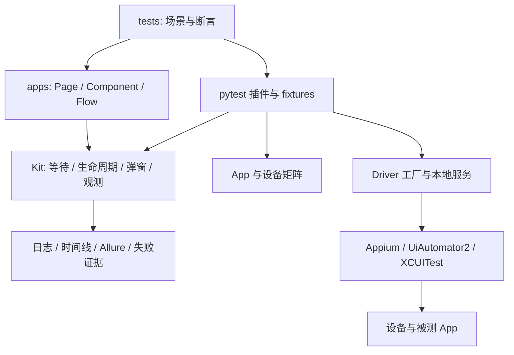
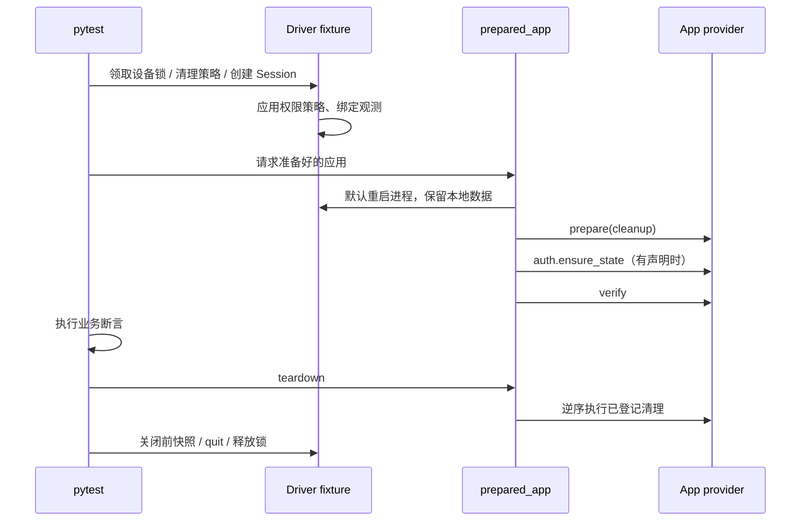

# Kit 架构设计

## 目标与边界

目标是让每条移动用例拥有明确前置条件、独占设备、可追踪的执行过程和可靠的退出路径。当前交付形态是可克隆的 pytest 仓库模板；PROJECT_ROOT、配置路径和插件加载都以该仓库结构为基础。不能把目录拷贝到 site-packages 就视为完成独立 SDK 发布。

框架不内置业务账号、不决定某个 App 的首页、不猜测未知弹窗的处理方式，也不声称能从缺失的应用日志推导网络根因。

## 分层与依赖

| 层 | 应包含 | 不应包含 |
|---|---|---|
| tests | 前置依赖、业务输入、结果断言 | 重复的底层定位和隐式执行顺序 |
| Page | 页面动作、明确的就绪判断 | 账号池和设备调度 |
| Component | 弹窗等可复用 UI 单元 | 完整业务流程 |
| Flow | 多页面组成的用户旅程 | 设备服务启动 |
| kit | 资源、状态生命周期、通用观测 | Kazumi 的定位器、登录凭证 |

现有插件仍保留一个 `update_notice_test` 的历史注册及跳过证据兼容分支。这是尚未完全去除的示例耦合；新增 App 不应继续在 kit 中增加同类特殊分支。

## 模块职责

| 模块 | 职责 |
|---|---|
| preflight.py | 检查选中包的平台、标识与真机描述文件/签名；声明能力适用性 |
| config.py | 读取 YAML、筛选目标、校验重复设备/端口 |
| driver_factory.py | 构建平台 capability 和 Remote Session |
| appium_service.py | 检查、启动、关闭本地托管服务 |
| device_lock.py | POSIX 文件锁，避免本机多进程争用设备 |
| pytest_plugin.py | 参数化、xdist 分组、fixture 和结果钩子 |
| lifecycle.py | 重启、准备、认证、验证及逆序清理 |
| overlays.py | 同步执行已注册的已知弹窗处理器 |
| telemetry.py | 关联 ID、步骤、命令耗时与字段脱敏 |
| observability.py | 截图、XML、平台日志、manifest 和 Allure 附件 |
| pages/base_page.py | 显式等待与基础定位能力 |

## 一条用例的时序

直接使用 `driver` 的用例不会自动经过 prepared_app；首次启动测试可以因此保留引导页面。`relaunched_app` 是兼容别名，不是另一轮独立重启。

## 失败语义

- 配置不合法、认证适配器缺失：setup error，不运行业务断言。
- prepare 或 verify 失败：执行已登记的补偿，原始异常仍抛出。
- 业务断言失败：保存 call 阶段证据，再走正常 teardown。
- 清理失败：其余清理继续；teardown error 单独报告，不把业务失败变成通过。
- Session 创建失败：记录异常和缺少 driver 的原因，截图不可用时不伪造。
- 日志采集失败：manifest 写明缺失项，不替换原始测试异常。

cleanup 必须在可能产生副作用的操作之前登记，并设计为可重复执行；框架不能强制第三方接口满足幂等性。setup 失败后的截图可能晚于补偿操作，时间线和采集时间应一起查看。

## 并行模型

目标来自兼容的 App × device 组合；xdist `loadgroup` 将相同 target 放到同一个 worker。分组 hook 使用 tryfirst，确保 xdist 读取时已存在标记。一个物理设备上的多个 App target 仍由设备锁防止并发，但当前没有跨 App 的最优调度保证；这种运行建议显式拆批。

自动管理的服务每个并行设备使用独立端口。文件锁只保护本机，Windows 和跨机器协调未实现。端口校验主要检查配置中的冲突，不等同于系统级端口预留。框架不自动开机、发现或分配设备池。

## 设计取舍

1. 每条用例独立 Session：减少 Session 故障传播，代价是启动开销。复用的是 App 持久化状态，不是 Driver。
2. 用例按需声明状态：避免每次全量清除拖慢运行，也避免暗中依赖前一条用例。
3. 显式验证页面：共享文本不能作为路由完成的唯一证据。
4. 同步处理已知弹窗：避免后台线程与业务步骤竞争点击；未知弹窗让错误暴露。
5. 不默认重跑失败测试：保留首次失败证据，避免把实际缺陷变成偶发通过。
6. 每条 Session 关闭前保留快照：有助于 teardown 诊断，代价是 I/O、耗时和存储。

## 后续拆分标准

pytest_plugin.py 是当前主要编排入口；当第二个真实 App 接入并证明协议稳定后，可拆分配置、状态和报告插件。独立 Python 包发布需补齐构建配置、运行时依赖、配置目录参数和安装测试。账号池或设备云应在真实需求出现后以 backend 接口接入，避免只增加空目录。
